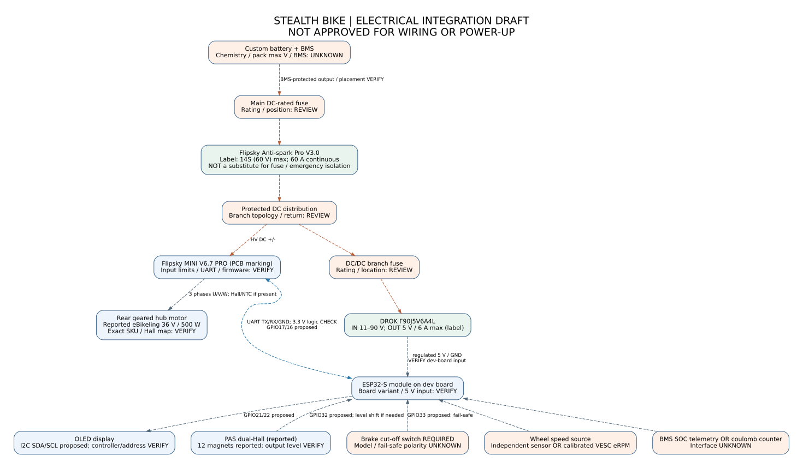

# Stealth Bike — electrical integration wiring draft

**Status: DRAFT / NOT APPROVED FOR WIRING, ENERGIZATION OR RIDING.**  Updated 2026-11-18.  Based on team-provided photos and `PROJECT_PLAN(1).md`, `README(1).md`, `SOFTWARE_INPUT_CHECKLIST.md`, and the legacy motor/OLED source files. No live wiring, bench validation, repository write, or VESC Tool readout was performed.

The diagram shows **functional relationships**, not confirmed wire-to-wire pinouts. **Every dashed edge is unverified.** Battery/BMS output arrangement, fuse position, branch protection, disconnect/precharge and returns require qualified electrical review. Do not assume the anti-spark device is an emergency disconnect or fuse.

## Evidence from photographed hardware

| Part | Evidence | Remaining uncertainty |
|---|---|---|
| DC/DC | DROK F90J5V6A4L label: input 11–90 V; output 5 V / 6 A maximum; label indicates red IN+, black IN−, black OUT−, yellow OUT+ | Validate leads, no-load/load output and ESP32 board power pin; 6 A is converter maximum, not a required load |
| ESP | Photo shows ESP32-S radio module on an ESP32 development board | Exact carrier board, header orientation, safe GPIO, 5 V power entry and flashing target |
| VESC | PCB silkscreen `MINI V6.7 PRO` and Flipsky markings; phase terminals marked A/B/C | Input voltage/current limits, firmware, UART connector pinout, sensor pinout, baud and timeout |
| Anti-spark | Flipsky Anti-spark Switch Pro V3.0 label: 14S (60 V) max, 60 A continuous, 800 A peak | Switch wiring and whether any separate safety isolation/precharge is needed; peak is not continuous rating |
| Battery/BMS | Team plan reports nominal ~40 V homemade battery | Chemistry, max charge voltage, capacity, BMS, continuous/peak currents and pack protected output |
| Motor | Team plan reports eBikeling 36 V / 500 W 700C geared hub | Exact motor label, phase/Hall mapping and eRPM-to-wheel-speed ratio |
| OLED | Earlier photo has PCB marked `2.42OLED-IIC VER:1.1` and I2C GND/VDD/SCL/SDA | Controller, address, resolution, voltage/pullups; older source assumes SSD1306 128x64, not verified |

**Source inconsistency:** Supplied `README(1).md` simultaneously describes an ESP32 firmware baseline and says the latest photo is ESP8266. The new photo in this task shows **ESP32-S**, while an earlier photo showed ESP8266. Record both as hardware revisions; confirm which board is physically installed before any firmware upload. Do not silently treat the boards as interchangeable.

## Proposed firmware interface — NOT pinout approval

| Function | Candidate ESP32 GPIO | Gate before connection |
|---|---|---|
| VESC TX -> ESP RX | GPIO16 | Actual VESC TX/GND pins and voltage ≤3.3 V |
| ESP TX -> VESC RX | GPIO17 | Actual VESC RX pin, baud, signal reference and watchdog |
| OLED SDA/SCL | GPIO21 / GPIO22 | Confirm I2C address, 3.3 V-safe pullups and supply |
| PAS pulse | GPIO32 | Measure channel(s), supply, logic high and 12 pulses/rev assumption |
| Brake cutoff | GPIO33 | Install switch; define and test fail-safe open-circuit state |

## Cable routing / physical harness planning

- **Battery zone:** isolate and protect pack leads, use approved strain relief; place the main fuse according to the pack/BMS protection design, not by assumption.
- **Controller zone:** mount VESC with appropriate cooling and strain relief; keep motor phase leads away from low-level PAS/UART/I2C runs when practicable.
- **Low-voltage zone:** mount DC/DC on suitable heat-sinking/support, route protected DC input separately from its 5 V output, and secure ESP32 in an insulated enclosure.
- **Handlebar zone:** route OLED and brake wires with steering slack; protect against pinch points and water. **Crank zone:** route PAS lead away from drivetrain abrasion.
- **Rear-wheel zone:** protect phase/Hall cable at axle and moving joints; maintain service loop without wheel contact.
- **Lengths:** measure on the actual bicycle along secured routing paths with steering fully turned and suspension travel accounted for. No numeric lengths are justified by supplied photos.

## Power-up blockers

1. Written pack/BMS chemistry, series count, full-charge voltage and discharge limits.
2. VESC Tool read-only screenshots of hardware/firmware, battery/motor current limits, input max voltage and UART timeout.
3. Fuse DC voltage and interrupt ratings, disconnect/precharge design, connector ratings and branch protection.
4. ESP32 power input and verified regulated 5 V output, grounds, and all GPIO voltage levels.
5. Confirmed motor phases/Hall/temperature mapping and controller compatibility.
6. Brake cut-off installed with open-wire fail-safe behavior and tested with motor commands disabled.
7. Wheel speed validated (independent sensor or calibrated VESC eRPM) and honest SOC source selected.

**No motor commands or vehicle power-up are authorized by this document.** Use the supplied software checklist and the separate verification checklist for evidence capture. Keep `ENABLE_MOTOR_OUTPUT=0` in the integration baseline until approved gates pass.
